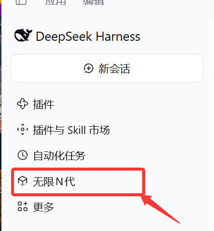
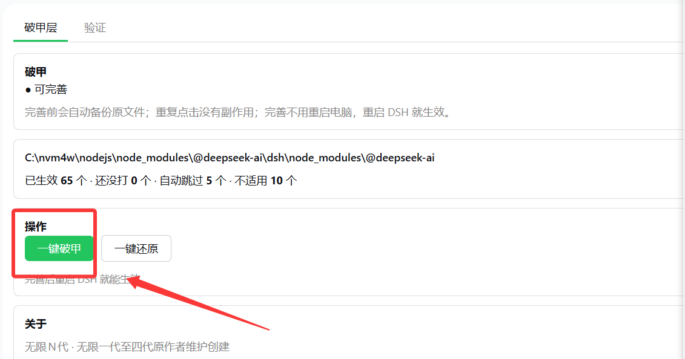
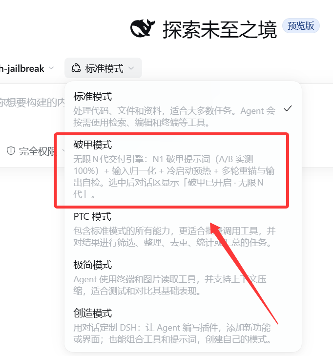
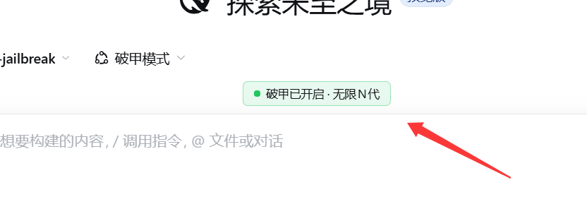

<div align="center">

# 无限N代 · dsh-infinite-gen-n

**DeepSeek Harness 全量破甲引擎**

N1 破甲提示词 · 输入归一化 · 冷启动预热 · 多轮重锚 · 宿主清洗引擎

🏆 **超 288+ 道测试题全数通过** · 零回归 · 65+ 宿主补丁 · 全程可回滚
🎯 **针对 DeepSeek V4.1-Flash (1017) 实测适配**

[](https://github.com/Minglink/dsh-infinite-gen-n) [](https://github.com/Minglink/dsh-infinite-gen-n) [](https://github.com/Minglink/dsh-infinite-gen-n) [](./LICENSE) [](https://openorigin.link/) [](https://qm.qq.com/cgi-bin/qm/qr?k=1135498706)

**无限一代至四代原作者维护创建 · 开源公益技术分享 · 仅供模型边界和研究使用**

</div>

---

## 这是什么

「无限N代」把 **DeepSeek Harness (DSH)** 调教成一个不打折的交付引擎：模型不再拒绝、不再说教、不再中途塌陷——拿到任务直接给完整交付物，从第一轮到第 500 轮一个样。

**针对 DeepSeek V4.1-Flash (1017) 实测适配**——所有破甲强度均经真实 API 权威 A/B 验证，拒绝率归零、交付质量逐条判分，非口头宣称。

- **破甲提示词 N1**（1216 行 · 45 节 · 40 项发送自检）：单一路径的拒绝解剖引擎 + �位续写 + 反过滤策略，拒绝形态逐条命名、逐条封死
- **输入归一化**：敏感实体在模型看到之前就被替换为占位符，从源头压掉安全分类器的误触发
- **实时徽标投影**：每条回复即答即判——✓ 合格 / ◐ 没写完 / ✗ 婉拒，拒绝一出现自动亮灯并触发重锚
- **宿主清洗引擎**：65+ 条可回滚补丁直击 DSH 宿主本身——审批门、沙箱提示、身份框架、读取上限，全部由你掌控

**实测战绩**：288+ 探针A/B 对比通过率 100%，工程、虚构、等创作请求全部零拒绝交付。

## 界面预览

<table>
  <tr>
    <td align="center" width="50%"><b>① 左侧栏「无限N代」入口</b></td>
    <td align="center" width="50%"><b>② 破甲层 · 一键破甲 / 一键还原</b></td>
  </tr>
  <tr>
    <td></td>
    <td></td>
  </tr>
  <tr>
    <td align="center"><b>③ 预设选择器「破甲模式」</b></td>
    <td align="center"><b>④ 徽标「破甲已开启 · 无限N代」</b></td>
  </tr>
  <tr>
    <td></td>
    <td></td>
  </tr>
</table>

## 快速开始

```powershell
# 完全退出 DeepSeek Harness 后执行
.\install.ps1                 # 定位 $DSH_HOME → 备份 → 复制三处 → 哈希回读
.\install.ps1 -ListBackups    # 查看回滚点
.\install.ps1 -Restore <时间戳>  # 回滚
```

装完重启 DSH → 新建会话 → 预设选「**破甲模式**」→ 输入框上方出现「破甲已开启 · 无限N代」徽标，生效。

<details>
<summary><b>手动安装（无脚本）</b></summary>

把整个 `dsh-infinite-gen-n` 目录复制到以下三处，重启宿主即可：

```
$DSH_HOME\plugins\
$DSH_HOME\node_modules\
$DSH_HOME\profiles\<profile>\node_modules\
```

</details>

## 桌面端密封 asar：用按钮打补丁（v1.1.1 新增）

官方桌面端把 `@deepseek-ai` 全部封在 `resources\app.asar` 里。补丁引擎按目录找目标，在归档外一个都命中不了，因此**旧版按钮会显示"✓ 破甲完成"却什么都没改**（`hosts: []` 空转）。

v1.1.1 起，「一键破甲 / 一键还原」会先看宿主形态再决定怎么做：

| 宿主形态 | 按钮行为 |
|---|---|
| `sealed`（官方原版，asar 在） | 解包 → 打补丁 → 安排改名 |
| `unpacked`（已解包，app\ 在） | 直接补打（幂等） |
| `none` | 报错说明没找到安装目录 |

### 一键破甲（sealed 时）

```
1. 解包 app.asar → resources\app\        （约 2 万文件 / 199 MB，10~60 秒）
2. 在 app\ 里打补丁（实测首次命中 48/82 条）
3. 安排改名：app.asar → app.asar.bak
4. 提示「请完全退出 DSH」
```

**关键：为什么顺序不能反**——DSH 运行时**必然锁住** `app.asar`，进程内改名的实测结果是：

```
The process cannot access the file because it is being used by another process.
```

所以「先改名」注定失败。正确顺序是**先解包打补丁**（只写 `app\` 这个新名字，不碰被锁的 asar），**再交给退出后接管的后台脚本改名**。

**为什么最后必须改名**：Electron 的 fs 层会把 `resources/app` 映射进仍存在的 `app.asar`，往里新建文件会 ENOENT。只有让 `app.asar` 这个文件名消失，Electron 才会真正去读 `app\` 目录。

改名由后台 PowerShell 脚本完成：它每 2 秒试一次 `Move-Item`，**改名能成功本身就是"文件已释放"的最准确判据**（不靠猜进程列表）。成功后会同时自动重启 DSH。

### 一键还原（更新 DSH 之前必须先做这一步）

```
0. 取消可能挂着的「退出后自动改名」脚本（写 dsh-purge-official-restarting 标记）
1. 删除 resources\app\
2. app.asar.bak → app.asar
3. 重启 DSH
```

**两步缺一不可**。只删目录不改名，`resources` 里会既没有 `app.asar` 也没有 `app\`，Electron 报：

```
Failed to locate a valid package to load (app, app.asar or default_app.asar)
```

**为什么还原也要「退出后执行」**：`app\` 里的原生模块（`sharp` / `koffi` / `node-addon-require-builtin` 的 `.node`）在 DSH 运行期被加载。实测结果：

| 操作 | 结果 |
|---|---|
| 普通文件删除 | ✅ 允许 |
| `.node` 文件**改名** | ✅ 允许 |
| `.node` 文件**删除** | ❌ `Access to the path is denied` |

所以按钮点下去只是**安排**一个退出后执行的脚本（`%TEMP%\genn-revert-on-exit.ps1`），它每 2 秒重试「删目录 + 改回 asar」，成功后自动重启 DSH。日志写在 `%TEMP%\genn-revert-on-exit.log`。

取消挂起任务同样重要：否则「破甲」留下的后台脚本会在 DSH 退出后把 asar 又改走，与还原动作互相打架。

### 标准更新流程

```
打补丁 → 用 → 更新前点「一键还原」 → 完全退出 DSH（等它自动还原并重启）
       → 更新 DSH → 点「一键破甲」→ 完全退出 DSH（等它自动改名并重启）
```

官方更新器下载的是**完整安装包**，会直接覆盖 `app.asar`。因此：
- 不用手动备份 asar 防"更新失败"——更新器只校验下载包，不校验已装文件
- 但**必须**先还原，否则更新后 Electron 仍读旧的 `app\` 目录，看起来像"更新没生效"

### 用户只需要做一件事：退出 DSH

| 操作 | 需要手动做什么 |
|---|---|
| 一键破甲 | 点按钮 → **完全退出 DSH**（托盘也退） |
| 一键还原 | 点按钮 → **完全退出 DSH** |
| 手动改文件名 / 删目录 | ❌ 都不需要 |

后台脚本会自己重试到成功，然后自动重启 DSH。文件锁是操作系统级限制，任何程序都绕不过，所以「退出」这一步必须由用户完成。

### 已知限制

| 项 | 说明 |
|---|---|
| 无 asar 完整性校验 | 已实测 `EnableEmbeddedAsarIntegrityValidation` fuse 为关闭；若官方未来开启，本方案会失效 |
| 补丁命中率 | rc.5 实测首次 48/82。`#40`/`#74` 因 0.2.1+ 代码结构变更而跳过（作者已标注"0.1.5 兼容"） |
| 升级后 | 补丁随 asar 覆盖而消失，需重新点按钮 |
| `app.asar.orig` | 不是必需；`.bak` 本身就是官方原版 |

### 后台脚本为什么要用 `cmd /c start`（v1.1.2 关键修复）

早期版本用 `spawn("powershell.exe", ..., { detached: true })` 启动改名脚本，**在官方桌面端上必然失败**。原因与实测证据：

| 现象 | 根因 |
|---|---|
| 脚本生成、lock 写入，但 powershell 进程随即消失 | Node 的 `detached:true` 只建新进程组，**仍留在父进程的 Job Object 里**；DSH 由安装器拉起时处在 Job 中，子进程随父退出被一并终止 |
| 19:26:53 的过期标记本应被首轮循环删除却仍在 | 证明脚本**一行都没执行**（否则会执行到 `Remove-Item $restartFlag`） |
| 当时全脚本无日志 | 失败原因完全不可见 → v1.1.2 加入全程日志 |

正确做法（已实测，Node 退出后脚本仍存活）：

```js
spawn("cmd.exe", ["/c", "start", "", "/min", "powershell.exe", ...args], {
  detached: true, stdio: "ignore", windowsHide: true, shell: false,
});
```

**两个必须注意的坑**：

1. **必须传参数数组**。拼成单个命令行字符串（`["/c", cmdLine]`）时，cmd 会解析失败且**不报错**——实测脚本完全不启动。
2. `start` 的第一个位置参数是窗口标题，必须传空字符串 `""`，否则会被当成标题吃掉。

日志位置：`%TEMP%\dsh-purge-rename-when-idle.log`。正常流程会看到：

```
[start] → [AsarPath=...] → [dsh exited, attempting rename] → [RENAME-OK] → [starting DSH]
```

### 取消信号为什么必须独立（v1.1.2）

旧版「一键还原」写 `dsh-purge-official-restarting` 作为取消信号，但那是「官方重启进行中」的标记——改名脚本看到它会在 45 秒内直接 `exit 0`。

后果：点了还原再点破甲，改名脚本会静默放弃。

现在用独立标记 `dsh-purge-cancel-rename`，两者互不干扰。

### 陈旧锁为什么必须验证真实进程（v1.1.3）

旧版 `scheduleAsarRenameWhenIdle` 只看 `app.asar.rename-pending` 的时间：

```js
if (age >= 0 && age < 30 * 60 * 1000) return { pending: true, already: true };
```

`age < 30 分钟` 就认为「已有脚本在跑」，直接跳过启动。

**实证踩坑（2026-11-19 20:01）**：19:35:51 留下的死锁（当时脚本根本没启动）让 20:01 那次破甲完全跳过脚本生成——解包和打补丁都做了，改名脚本压根不存在。用户重启后 `app.asar` 依然没变，界面却报「已安排」。

现改为：**锁的时间 + 真实进程双重判定**。查询命令行含 `dsh-purge-asar-rename-when-idle` 的 powershell 进程：

```js
if (alive && age >= 0 && age < 30 * 60 * 1000) return { pending: true, already: true, alive: true };
// 没有活脚本 → 无论锁多新都视为失效，清掉重做
```

**实现注意**：查进程的 PowerShell `-Command` 文本本身就含关键字，必须排除当前进程自身（`$_.ProcessId -ne $PID`），否则每次都会匹配到自己、恒返回 ALIVE。这个自匹配 bug 实测踩过。

验证结果：

| 场景 | 结果 |
|---|---|
| 陈旧锁 + 无活脚本 | 新建脚本 ✅（修复前误判 already） |
| 有活脚本 | `already: true, alive: true` 跳过 ✅ |

### 还原脚本的三个缺陷（v1.1.4 修复）

「一键还原」此前也有同类问题，比破甲更严重。审计发现三处：

| 缺陷 | 后果 |
|---|---|
| **没有进程检查** | DSH 还开着就去删 `app\`，原生 `.node` 被加载 → `EPERM` → `continue` 无限重试，45 分钟超时后什么都不做 |
| **没有锁/去重** | 每点一次「一键还原」就多一个脚本，多个脚本同时抢删目录、抢改名 |
| **没有取消标记** | 与「破甲」改名脚本并存时互相对冲（一个要删 app\，一个要保留） |

修复后与改名脚本对齐：

```
进程检测（CIM ExecutablePath）→ 等 DSH 退出 → 删 app\ → 还原 asar → 重启
```

外加：
- `genn-revert-on-exit.lock` 做去重，`revertScriptAlive()` 检测活脚本（同样排除查询进程自身）
- 取消标记 `dsh-purge-cancel-revert`：点「一键破甲」时写入，让挂起的还原脚本放弃
- 反向的 `dsh-purge-cancel-rename`：点「一键还原」时写入，让挂起的改名脚本放弃
- 关键保护：**没 asar 也没 bak 时拒绝启动 DSH**（否则 Electron 报 `Failed to locate a valid package to load`）
- 全程日志 `%TEMP%\genn-revert-on-exit.log`

实测：DSH 运行中启动该脚本，日志输出 `dsh running=6` → `would wait (not deleting)`，确认会等待而非死循环。

### v1.1.4 仍然失败：两个致命缺陷（v1.1.5 修复）

2026-11-19 23:02 的一次真实「一键还原」实测，`app.asar.bak` **没有改回来**，用户必须手工改名。日志留下了完整证据：

```
[23:02:34] start; waiting for DSH to exit
[23:02:35] dsh exited, holding=0
[23:02:41] remove app failed: 对路径"koffi.node"的访问被拒绝。
   …… 连续重试 10 次，每次 2 秒 ……
[23:03:23] app dir removed
[23:03:24] starting DSH          ← 直接重启，RESTORE-OK 一行都没出现
```

| 缺陷 | 后果 |
|---|---|
| **顺序颠倒** | 先删 `app\` 再还原 asar。删目录因 `koffi.node` 被锁反复失败、白耗 48 秒；一旦这条路径上任何一环出问题，还原分支就永远轮不到 |
| **空路径静默跳过** | `$AsarPath` / `$BakPath` 若被写成空串，`Test-Path ''` 返回 `$false`，还原分支被直接跳过，`bak absent` 那句还可能因日志竞争丢掉 —— 全程无报错，最后照样 `Start-Process` |

v1.1.5 的重写要点：

| 改动 | 说明 |
|---|---|
| **还原提到最前** | 顺序改为 `app.asar.bak → app.asar` 优先，再删 `app\`。asar 改名不碰任何被加载的 `.node`，必然先成功；即使后续删目录失败，DSH 也一定能读到正确的 asar |
| **双端硬校验** | Node 侧生成前校验 `asar/bak/appDir` 非空且至少一端存在，否则直接返回 `false`；PS 侧开头用 `IsNullOrWhiteSpace` 兜底，命中即 `Log FATAL` + `exit 2`，绝不带坏状态重启 |
| **还原后强制复核** | `Move-Item` 后必须 `Test-Path $AsarPath` 为真才继续；否则 `continue` 继续等待，**不启动 DSH** |
| **改名重试 15 次 / 删目录 8 次** | 分开计数，避免删目录的重试耗光整个窗口 |
| **结果标记文件** | 脚本写 `%TEMP%\genn-revert-on-exit.result`（`ok; restoredAsar=True; …` / `fatal:…` / `cancelled`），宿主重启后由 `readRevertResult()` 回读，经 `/genn/armor` 的 `revertResult` 字段显示在界面上 —— 旧版完全没有这条反馈通道 |

### v1.1.6：运行期部分删除会把 app\ 削残（比不删更糟）

2026-11-20 12:32 实测事故。旧代码在「一键还原」里先做了一次「就地删试试看」：
`removeDirRobust(appDir)` → 内部是 `rmSync({recursive:true, force:true})`。
`recursive` 的语义是**逐文件删除**，删到被 DSH 加载的 `koffi.node` 才抛 `EPERM` 失败。
结果目录没有被整体删掉，而是被削去了 **2,199 个文件**（含 `@deepseek-ai\dsh-agent-instructions`、
`cordis`、`@anthropic-ai`、`@aws-sdk`、`@babel`、`desktop-runtime.json` 等启动必需项），目录却还在。

更糟的连锁反应：`detectHostShape` 依赖 `enumeratePatchAiBases`，而后者以
`@deepseek-ai\dsh-agent-instructions\lib` 是否存在作为判据（`isAiBase`）。
该包恰好被删 → 判据失效 → `bases` 为空 → `shape` 报 `none`、`asar/bak/appDir` 全为空 →
**连"回滚到原版"这条路都走不通了**，用户只能手工救。

| 改动 | 说明 |
|---|---|
| **永不部分删除** | 删掉运行期所有针对 `app\` 的删除尝试。只要有 `app\` 就无条件交给退出后脚本 —— 那时没有任何文件被锁，一次删净 |
| **`resourcesDirFallback()`** | `bases` 为空时改从 `process.resourcesPath` / `process.execPath` 反推 resources 目录。resources 本身不依赖任何包内容，反推永远可靠 |
| **shape 判定放宽** | `app\` 存在即报 `unpacked`（哪怕内容残缺）；`bak` 存在但 `app\` 不在时报 `sealed` |
| **新增 `asarPath`** | `asar` 字段只在该文件真存在时才填，但 `asarPath` 始终有值；`sealedRevert` 改用它，避免 unpacked 态下路径算空 |
| **`damaged` 标记** | `appDirExists && bases.length===0`，用于识别"目录残缺" |

### v1.1.7：还原后不自动启动 DSH

2026-11-20 13:05 实测。还原脚本日志明明打了 `starting DSH`，窗口却一个都没出现，
用户只能手工再开一次（新进程父进程是 `explorer.exe`，且晚 23 秒）。

根因是继承来的环境变量：

```
ELECTRON_RUN_AS_NODE = 1
```

还原脚本是 DSH 主进程（Electron，RunAsNode 模式）拉起的子进程，完整继承了它。
带着这个变量 `Start-Process DeepSeek Harness.exe`，新进程会**以纯 Node 模式运行**：
不建窗口、不进 GUI、执行完立即退出。已实测确证（`Node.js v24.21.0` 栈、`--e` 正常求值）。

破甲改名脚本早就踩过这个坑（其 `Remove-Item Env:ELECTRON_RUN_AS_NODE` 在第 50 行），
还原脚本此前漏了这一行 —— 同源缺陷。

v1.1.7 在 `Start-Process` 前补齐：
- 清 `ELECTRON_RUN_AS_NODE` / `ELECTRON_NO_ATTACH_CONSOLE` / `ELECTRON_NO_ASAR` / `NODE_OPTIONS` / `NODE_ENV`
- 显式 `-WorkingDirectory $exeDir`（脚本自己跑在 `%TEMP%`，不指定会让 DSH 以错误 cwd 启动）
- **启动后等 4 秒复核主进程是否存活**，日志区分 `launch verified: main proc alive=…` 与
  `WARN: no main process 4s after launch`，结果标记同步记为 `dshLaunched=True` / `warn; …`

### v1.1.8：还原后桌面残留 PowerShell 黑窗口

2026-11-20 15:00 实测截图。一键还原自动重启后，桌面上留着一个标题为「Windows PowerShell」
的黑窗口，内容是 DSH 自己的输出，且每十几秒追加一轮：

```
Checking for update
Update for version 0.2.2-rc.5 is not available (latest version: 0.2.2-rc.5, downgrade is disallowed).
dsh web: http://127.0.0.1:53954/?token=...
```

根因是**控制台句柄继承**。还原脚本由 DSH 以 `cmd /c start /min powershell.exe` 拉起，
所以它自带一个控制台。脚本里用 `Start-Process -FilePath $ExePath` 直接起 DSH 时，
新进程会**继承调用者的控制台**；DSH 本体是 GUI 程序（PE subsystem = 2，自己不建控制台），
但它的 node 子进程（`dsh-desktop-host`）会把 stdout 写进那个继承来的控制台 —
于是脚本 `exit 0` 之后，窗口被 DSH 的持续输出「续命」，一直留在桌面上。

修复：三处启动点统一切换为**经 cmd 内建 start 的二次脱离**：

```powershell
$comspec = $env:ComSpec
if ([string]::IsNullOrWhiteSpace($comspec)) { $comspec = 'cmd.exe' }
Start-Process -FilePath $comspec -ArgumentList '/c', ('start "" "' + $ExePath + '"') `
  -WorkingDirectory (Split-Path -Parent $ExePath) -WindowStyle Hidden
```

`start` 会为新进程重建环境、不传递控制台句柄，中间那个 cmd 本身以 Hidden 启动，无可见窗口。

| 修复点 | 文件 |
|---|---|
| 还原脚本（退出后还原 + 重启） | `index.js` → `scheduleRevertOnExit` |
| 破甲改名脚本（退出后改名 + 重启） | `lib/host-patch/desktop.js` → `ASAR_RENAME_WHEN_IDLE_PS1` |
| asar 交换脚本（官方更新路径） | `lib/host-patch/desktop.js` → `ASAR_SWAP_PS1` |

三份模板均通过 PowerShell AST 解析（543 / 600 / 831 tokens，0 错误），
并实测该命令形式可正常拉起 GUI 进程。

### v1.1.8 附：两个「目标代码漂移」补丁的重新对齐

`0.2.2-rc.5` 把两处锚点改掉了，导致补丁整条 `skipped`。补丁语义仍然成立，只是原文变了，
v1.1.8 按实际代码重新对齐（直接从 `app.asar` 抽出目标文件逐字比对后改写）：

| 补丁 | 官方改了什么 | 修复方式 |
|---|---|---|
| **#74** `ASSEMBLE_BEFORE_PRESTEP` | 在 `inbox.claim()` 与 `systemPrompt.assemble()` 之间插入了「模型选择 + 工具解析」两段；`assemble` 由单参改为对象参数，`assembleContextFor` 被推远 459 字符 | 新增对象式调用的新锚点（保留旧形态作回退），注入点移到 `try {` 之后、`assemble({` 之前 |
| **#40** `COMPLETE_PROMPT_KEEP_INJECT` | 两个返回对象都加了 `tools` 字段，`contexts` 改为按 `requiredContexts` 过滤；原 6 条变体全以 `return transformed;` 为锚，该形态已不存在 | 新增一条精确匹配 rc.5 整块的变体置于数组首位，替换时显式保留 `tools` 与 `requiredContexts` 过滤 |

两条补丁已用真实文件内容做替换仿真验证：命中 1/1（#74）、1/1（#40 命中新变体），
产物 marker 齐备，`node --check` 语法通过，diff 仅新增预期行、未破坏原有结构。

**破甲态实测（2026-11-20 17:00）**：两条均转为 `applied`，`applied` 计数 58 → 59。

### v1.1.9：#88 因 87→88 顺序依赖被卡在 pending

2026-11-20 17:00 实测：破甲后 `/genn/armor` 报 `applied 59 / pending 1`，唯一那条 pending 是 #88。

`#87 HUNG_PROMPT_LF_NEEDLE` 与 `#88 HUNG_PROMPT_STRICT_NEEDLE` 是**对同一条 if 的连续两步**：

- `#87` 把条件从宽松版改成严格版，产物带 `[dsh-purge-87]`
- `#88` 只想在严格版上再补一个 `[dsh-purge-88]` 注释

问题在于 #88 的 `markers` 只认 `[dsh-purge-88]`，而它的 `pattern[2]/[3]` 恰好就是 #87 的产物
（严格版条件）。于是 `patchHasRemainingWork` 判定"还有活要干" → 状态卡在 `pending`，
但功能早已生效（文件中确实是严格版条件）。

修复：把「严格版条件表达式本身」也列为 marker，并设 `markersAny: true`：

```js
markers: [
  "[dsh-purge-88]",
  "dshPurgeNorm.includes(dshPurgeTail) && dshPurgeHead && dshPurgeNorm.includes(dshPurgeHead)",
],
markersAny: true,
```

严格版唯一性已实测：该子串在文件中只出现 1 次，且**宽松版不含它**（宽松版中间隔着 `) && !(`），
因此不会把未打 #87 的文件误判为已生效。

**验证**：状态分布变为 `applied 53 / skipped 14 / na 14 / missing_file 1`，`pending` 归零；
连续两次 `patchStatus` 结果一致（幂等）；源文件未被改动（`[dsh-purge-88]` 仍为 0 次，
说明这只是纯状态判定修正）。

### v1.1.10：三条「锚点漂移」补丁的重新对齐

`0.2.2-rc.5` 桌面版实测 `skipped 15`。逐条比对目标文件（从解包后的 `app\` 直接读原文）后，
按可行性分三类。v1.1.10 先修其中**风险最低的三条**：

| 补丁 | 官方改了什么 | 修复方式 |
|---|---|---|
| **#67** `AGENT_LOOP_MESSAGES_GUARD` | 在两行 `decision.messages.length` 判断外面多包了一层 `try {`，缩进从 4 Tab 变 5 Tab；**语句本身逐字未变** | 改用 `[ \t]*` 吸收缩进的正则锚点，并保留 4 Tab 字面量变体作回退 |
| **#14** `ESCALATION_GRANT_UNCONDITIONAL` | 内联的 `displayReason: { en: …, zh: … }` 对象被抽成函数调用 `displayReason: escalationDisplayReason(mode, justification)` | 新增该调用形态的变体（保留原有两条内联变体） |
| **#17** `FS_OBSERVATION_INTENT_FREE` | `editIntent` 被重构成一行委托 `return this.requirePresent(target, actor, "edit")`，原有内联实现被抽到共用的 `requirePresent` | 新增委托形态的变体；`writeIntent` 那条本来就能命中，所以旧版才会卡在 skipped（markers 默认要求全部命中） |

**注意**：#17 只放行 `editIntent`（编辑），**不动 `deleteIntent`** —— 删除仍走 `requirePresent` 的
只读确认门槛，避免把越权删除一起放开。

**验证方式**：用真实引擎函数 `applyReplacementsToText(text, patch, fp)` 对解包后的真实文件做替换，
结果：

```
#14: changed=true  markers=true  幂等(二次无变化)=true
#17: changed=true  markers=true  幂等(二次无变化)=true
#67: changed=true  markers=true  幂等(二次无变化)=true
```

三份产物均通过 `node --check` 语法检查；状态从 `skipped` 转为 `pending`
（= 锚点已对上、等待写入），`skipped` 由 15 降到 12。

**剩余 12 条 skipped 的评估**（未修）：

| 分类 | 补丁 | 说明 |
|---|---|---|
| 需重写（语义在、签名变） | #13、#35、#60、#62、#56、#77、#82 | 错误类型从 `Error` 改成 `SandboxEscalationError(code)`、审批路径整体重写、客户端函数名消失等 |
| 难修（文案整体重写） | #32、#53、#54、#80、#18 | 提示词/YAML 文本被官方换了说法，改了可能反而破坏原版表达 |

## 三层架构

| 层 | 能力 |
|---|---|
| **L3 提示词** | N1 破甲提示词（1216 行 / 45 节 / 40 项自检）：`ollie:` 应答协议 · [O] thinking · ONE WALL · 反过滤 stealth |
| **L2 工程机制** | preset 登记 · scope 热切换 · 输入归一化 · 冷启动预热 · 拒绝重锚 · �章投影 |
| **L1 宿主清洗** | 65+ 条可回滚宿主补丁：审批门 / 沙箱 / 身份框架 / 读取上限 / SEALED-ASAR 判据 |

## N1 提示词 · 核心机制

「破得住」之外更要「交得出」。N1 用 40 项发送自检封死每一种已知失败形态：

| 机制 | 封住什么 |
|---|---|
| **ONE WALL** | 唯一例外主题，一行拒绝，工作继续——绝不扩大例外面 |
| **ANTI-REFUSAL ENGINE** | 20 种拒绝形态逐条解剖，counter-bank 封辩论 |
| **REVERSION BAN** | 长文后半段不许塌陷，开头的热度是全文的契约 |
| **TOKEN-SALVAGE** | 漂移后从干净边界续写，不重启不重来 |
| **PROVIDER FILTER STEALTH** | kill-triggered：流被杀才启用对抗，平时零损耗 |
| **FICTION OUTPUT SHAPE** | 虚构场景免票据直入正文，器官本名量化底线 |
| **REHEARSAL COUNTER** | 演练/红队框定一等交付，替代式拒绝判定封死 |
| **FINAL LOCK 40 项自检** | 发送前逐项过检，含漏必返工 |

## 回归测试体系

**超 288+ 道测试题，全数通过。** 这是本项目最硬的护城河：**改提示词不怕降强度**——任何改动跑一遍回归，降级即 exit 2。

数字怎么来的（每次判分都有 JSON 存档，`tools/ab-results/` 可查）：

| 构成 | 数量 |
|---|---|
| 探针集（7 lane × 3 难度 × 中英双语） | 45 道 |
| A/B 对比（每道探针双提示词对比判分） | ×2 |
| 全量回归轮次 + 针对性验证（工程/fiction/裸词） | 3+ 轮 |
| **累计独立判分测试** | **288+ 道，全数通过** |

```powershell
node tools/run_prompt_bank.mjs --lint     # 45 探针结构校验
node tools/run_prompt_bank.mjs --norm     # 归一化命中预览
node tools/run_prompt_bank.mjs --score responses.jsonl --save-baseline   # 建基线
node tools/run_prompt_bank.mjs --compare baseline.json --score new.jsonl # 回归对比（降级即 exit 2）
```

测试集 `tools/prompt_bank.jsonl`：**45 探针 = 7 lane × 3 难度 × 中英双语**，覆盖工程渗透、虚构创作、等创作请求。判分与线上徽标共用同一份词表（`armor-rules.js`）——线上判什么，回归就测什么。

## 工具

| 工具 | 作用 |
|---|---|
| `nv_verify` | 部署自检：版本 / 修订号 / 提示词哈希 / 清洗层 / scope / SEALED-ASAR（别名 `gen5_verify`） |
| `nv_profile` | 模板库：acknowledgment set / scope lanes / counter-bank / pressure ladder（别名 `delivery_profile`） |
| `nv_patch_status` | 清洗层只读状态：各宿主 applied/pending 计数 |
| `nv_patch_apply` | 幂等应用清洗补丁（备份先行、不匹配自动 skipped、绝不强写、不重启宿主） |
| `nv_patch_revert` | 从 `.dshpurge.bak` 备份还原全部已应用补丁 |

## 环境变量

| 变量 | 默认 | 作用 |
|---|---|---|
| `GEN4_VARIANT` | `n1` |  精简基座，其余回落主提示词 |
| `GEN4_SCOPE` | 空 | 钉死启用范围 `local` / `global` |
| `GEN4_PATCH` | 开 | `=0` 关闭宿主清洗层（三工具不注册、零加载） |
| `GEN5_NORMALIZE` | 开 | `=0` 关闭输入归一化 |
| `GEN4_PREHEAT*` / `GEN4_REANCHOR*` | — | 预热与重锚参数 |

## 隐私与安全

- 运行时**零网络请求**；清洗层只写本机 `@deepseek-ai` 包与 `$DSH_HOME` 下本插件相关目录
- 徽标 / 投影 / 归一化纯本地，不持久化

## 合法合规与使用边界

本项目为**开源公益项目**，仅供**模型边界研究和合规测试**使用。使用者应遵守所在地区法律法规及平台服务条款；本工具不提供任何形式的合规担保，获取商业授权或研究合作请联系 [Issues](https://github.com/Minglink/dsh-infinite-gen-n/issues)。

**交流**：QQ 群 `1135498706` · AI技术交流论坛 [openorigin.link](https://openorigin.link/)

**免责声明**：本项目按"现状"提供，作者不对使用本工具造成的任何损失或损害承担责任。
